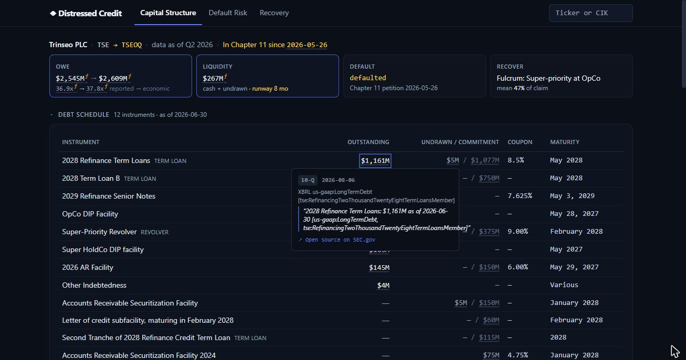

# Distressed Credit

[](https://github.com/pgarrett-ai/SSR_Platform/actions/workflows/ci.yml)

A research workbench for distressed and special-situations credit, built on SEC EDGAR.
Pick an issuer and it answers three questions: **what does it really owe, how likely is
default, and what does each tranche recover**. Every figure links to the filing it came
from: hover or click a number to see the accession, the form, the date and the quoted text.



## What you get

**A screen and an events feed.** The landing page lists every analyzed issuer with
economic leverage, liquidity runway and forensic flags, plus a feed of recent distress
events from EDGAR (8-K bankruptcy, acceleration and non-reliance items, late filings,
delistings, Schedule 13D/G stakes, rating defaults).

**One issuer strip, three tabs.** Every company page opens with the same strip: debt as
reported and as economic debt (leases, pension deficit, supplier finance), liquidity, a
12-month market-implied PD and the fulcrum security from the last recovery run.

- **Capital structure.** The debt schedule from XBRL and the debt footnote, reconciled
  to reported debt for the same period. Maturities against liquidity, with a
  refinancing verdict per year. The reported-to-economic debt bridge on one LTM EBITDA
  (operating income + D&A + impairments). Covenant packages per agreement family, with
  the liability-management levers each one leaves open: uptiering, drop-down
  (J.Crew), incremental debt, restricted-payment leakage. Forensic flags where cash and
  debt disagree.
- **Default risk.** Merton distance-to-default with a first-passage PD term structure,
  Altman Z'' over time, a gradient-boosted hazard model trained on real defaults (you
  train it locally; model card below), market and bond levels, and the issuer's EDGAR
  events.
- **Recovery.** A Monte Carlo waterfall over enterprise value: allowed claims (principal,
  accrued interest, make-wholes), lien ranks, structural subordination, the fulcrum
  class, recovery by tranche, IRR at your price, EV breakpoints, priority attacks,
  priming and an exchange-offer analyzer. Chapter 11 clocks appear when the issuer has
  filed.

## Example: Trinseo (TSE)

Trinseo filed for Chapter 11 on 26 May 2026. Open TSE and the strip says so, citing the
8-K Item 1.03. These figures come from the shipped snapshot (Q2 2026 10-Q, FY2025 10-K):

- **What it owes.** $2,545M of reported debt at FY2025, the last annual balance sheet
  before the petition, and $2,609M with leases. LTM EBITDA is $69M (operating income of
  -$215M plus $284M of D&A, TTM through Q2 2026), so leverage reads 36.9x reported and
  37.8x economic.
- **Liquidity.** $181M of cash and $86M of undrawn facilities against $401M a year of
  negative free cash flow: 8 months of runway.
- **Maturities.** The Q2 debt schedule carries $3,024M across eight drawn instruments.
  $588M falls due in 2027 (two DIP facilities and the 2026 receivables facility), $2,042M
  in 2028 (the term loans and the super-priority revolver), $391M in 2029 (the notes).
- **Recovery.** At 6.0x LTM EBITDA (4.5x in stress) with 7% estate costs, 50,000 draws
  put EV at a median of $358M (P10 $164M, P90 $616M) against $3,024M of claims. The
  super-priority class (the DIP facilities, the revolver and the receivables facility) is
  the fulcrum at a 47% mean recovery; the 2028 term loans get 0.2% and the notes nothing.
  $69M is trough EBITDA, so the base EBITDA in Assumptions is the first input to change.

## Quickstart

You need Python 3.13, Node 20 or later, and a SEC user agent ("Your Name you@email.com").
An Anthropic API key turns on the footnote, covenant and Exhibit 21 extraction; without
one, those sections stay empty and the XBRL-based analysis still runs.

macOS / Linux:

```bash
cp platform/.env.example platform/.env        # then set SEC_USER_AGENT (and ANTHROPIC_API_KEY)
python3 -m venv platform/backend/.venv
platform/backend/.venv/bin/pip install -r platform/backend/requirements.txt
npm --prefix platform/frontend ci
./platform/launch.sh                          # API :8001, events worker, UI :5173; Ctrl-C stops all
```

Windows (cmd):

```bat
copy platform\.env.example platform\.env
python -m venv platform\backend\.venv
platform\backend\.venv\Scripts\pip install -r platform\backend\requirements.txt
npm --prefix platform\frontend ci
platform\platform_launch.bat
```

Open http://localhost:5173. Four issuers ship as cached snapshots (AAL, ATUS, TSE, LCID),
so their Capital Structure and Recovery tabs render from the snapshot; the strip's PD
cell and the Default Risk tab need the network. Default Risk always runs live: it reads XBRL fundamentals from EDGAR and market data from Yahoo
Finance, so it needs a network connection (results are cached for the day). Any other
ticker or CIK runs live on every tab: about a minute without the LLM, a few minutes with
it.

The trained hazard model is not in the repo (`*.joblib` is gitignored). Until you train
it, Default Risk shows Merton and Altman only. A quick pass takes about 15 minutes; the
full panel behind the model card below is a multi-hour EDGAR fetch (checkpointed, so a
killed run resumes):

```bash
cd platform/backend
.venv/bin/python -m app.hazard.labels --defaulters 120 --controls 480 --start-year 2010    # quick
.venv/bin/python -m app.hazard.labels --defaulters 900 --controls 3600 --start-year 2010   # full
```

Tests: `cd platform/backend && .venv/bin/python -m pytest tests -q` (offline, under a minute).

## Default model card

The trained hazard model scores the probability that an issuer defaults within a year of
its 10-K becoming public. The numbers below describe the full-panel run; the bundle is
not committed, so train it first (see Quickstart).

- **Labels.** 580 default firm-years from 8-K Item 1.03 bankruptcies, the LoPucki BRD and
  Fitch/Moody's rating defaults (distressed exchanges, missed payments), 2010 to June 2026.
  The horizon starts 90 days after fiscal year end, when the 10-K could be public.
- **Controls.** 3,600 firms drawn from the point-in-time 10-K filer universe, including
  firms that later stopped filing, so survivors do not dominate. Every firm that ever
  defaulted is excluded from the controls. Survivor rows whose year-ahead window is not
  yet observed are dropped.
- **Features.** 13 accounting ratios (leverage, net debt/EBITDA with an explicit
  EBITDA ≤ 0 flag, coverage, liquidity, profitability, size, cash runway). No market
  data: defaulters rarely have clean price histories, and a model fed prices learns
  "has a price history means safe".
- **Model.** Gradient boosting with monotone constraints, so a worse ratio never lowers
  the PD. Probabilities are prior-corrected from the case-control sample (2.5%) to the
  measured base rate (0.94% a year).
- **Validation.** Expanding-window walk-forward with a one-year embargo. Pooled
  out-of-sample AUC **0.79** (by test year: 0.76 to 0.88 from 2012 on). Flagging the
  riskiest 10% catches 40% of defaults at 4.0x the base rate; the riskiest 5% catches
  27% at 5.3x.
- **Known limits.** Fundamentals come from each firm's latest filing, so restated
  values can leak into training rows. The safest decile still shows more defaults than
  predicted (1.0% against 0.02%), mostly firms with sparse XBRL. Rating-default labels
  stop in November 2024, so later distressed exchanges are missing from the labels.

Retrain from primary sources with
`python -m app.hazard.labels --defaulters 900 --controls 3600 --start-year 2010`
(EDGAR fetches are checkpointed; a cold run takes hours). It overwrites
`app/hazard/models/trained_hazard.joblib`.

## Methodology references

- Moyer, S. *Distressed Debt Analysis: Strategies for Speculative Investors* (2004):
  creation multiples, refinancing walls, the 40% yield test for a closed market,
  liquidity crisis triggers, plan and Chapter 11 timelines.
- Altman, E. (2000). Z'' score for non-manufacturers and emerging markets.
- Merton, R. (1974); Black, F. and Cox, J. (1976): first-passage default.
- King, G. and Zeng, L. (2001): prior correction for case-control samples.

## Data sources

| File | Source | Terms | Refresh |
|---|---|---|---|
| `app/hazard/data/default_events.json` | 8-K Item 1.03 filings via EDGAR full-text search (1,074 events, 2010 to 2026) | US government work | delete the file, then `python -m app.hazard.labels --defaulters 900 --controls 3600 --start-year 2010` (re-harvests from 2010, then retrains) |
| `app/hazard/data/sd_events.json` | Florida-UCLA-LoPucki Bankruptcy Research Database (988 cases); Fitch D/RD (69) and Moody's C (32) Rule 17g-7 histories via ratingshistory.info | LoPucki BRD: free for commercial and academic use with attribution. 17g-7 histories: SEC-mandated public disclosure | `python -m app.hazard.labels --harvest-sd` (needs the BRD cases CSV in `app/hazard/data/`; harvests only, retrain afterwards) |
| `app/hazard/data/pit_universe.json` | EDGAR quarterly form indexes: every 10-K filer by year (18,451 CIKs) | US government work | rebuilt by the labels run |
| `app/cache/*_3y.json` | Hero snapshots built by the app from EDGAR filings | US government work + derived analysis | `python -m scripts.build_hero_cache` |
| `app/cache/covenant_extracts/`, `app/cache/sponsor_extracts/` | LLM extractions of credit agreements and indentures (SEC exhibits) and of DEF 14A beneficial ownership; quotes checked verbatim against the source text | derived from public filings | rebuilt on a live run |
| `app/hazard/data/bond_quotes.json` | Your own bond marks (not committed; see `bond_quotes.example.json`) | yours | by hand |

This project uses the Florida-UCLA-LoPucki Bankruptcy Research Database (Lynn M. LoPucki).

## Limitations

- Single user, localhost by default. Set `PLATFORM_API_TOKEN` before exposing it.
- Capital structures come from XBRL and LLM extraction of filed documents. Private
  credit terms, loan-level data and unfiled amendments are invisible to it.
- The recovery model puts every tranche in one legal entity unless you map entities and
  collateral yourself; guarantees are not modeled.
- Merton PDs are risk-neutral. Read them as a market cross-check, not a forecast.
- Bond prices come only from the marks file you supply.

## Operations

- **Storage.** SQLite by default (`DATABASE_URL`). The event-store tables migrate with
  Alembic: `alembic upgrade head` on a new database. Legacy tables are created at
  startup.
- **Events worker.** `python -m app.worker` polls EDGAR and writes the event store.
  `python -m app.events.backfill --start 2020-01-01` seeds history. `/api/health`
  reports `worker.alive`.
- **Auth.** With `PLATFORM_API_TOKEN` set, every `/api/*` route except `/api/health`
  needs `Authorization: Bearer <token>`; the two progress streams use a same-origin
  cookie. Run it behind a TLS reverse proxy for anything internet-facing.

## License

Apache-2.0. Research tooling only; nothing here is investment advice.
